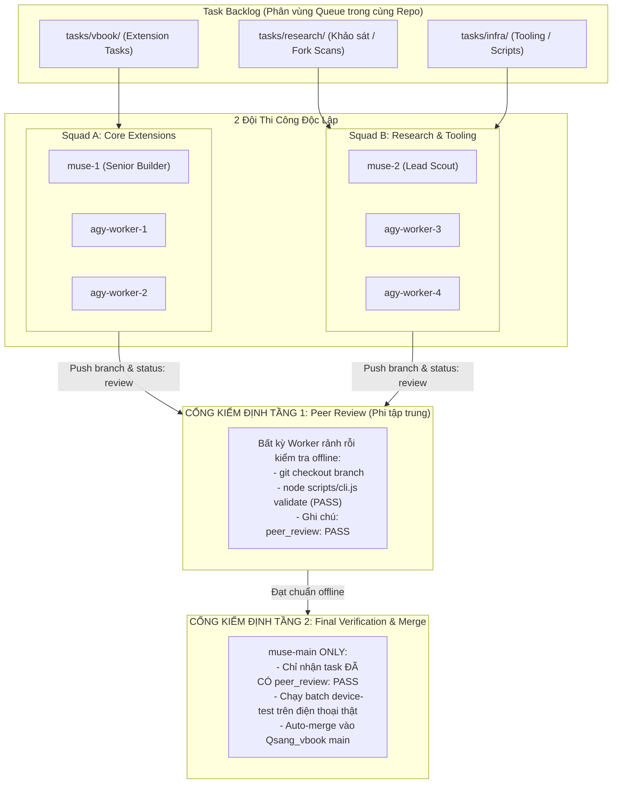

# ANTIGRAVITY-FINDINGS.md — Báo Cáo Đánh Giá Kỹ Thuật & Bản Thiết Kế Tối Ưu Hóa `muse-teamwork`

- **Ngày đánh giá:** 2026-11-16 (Phiên bản v2.0 cập nhật toàn diện sau phân tích Delta commit `705c625`)
- **Đơn vị thực hiện:** Antigravity Architecture & Code Review Sentinel (Google DeepMind Agentic Suite)
- **Kho lưu trữ mục tiêu:** [qsang2025/muse-teamwork](https://github.com/qsang2025/muse-teamwork)
- **Nhánh thực hiện:** `feature/antigravity-review` (tách từ `735a892`, đối chiếu với `origin/main` tại `705c625`)
- **Phạm vi tuân thủ:** Tuân thủ tuyệt đối quy định tại `docs/ANTIGRAVITY-REVIEW.md` (§5 Yêu cầu cốt lõi, §6 Giới hạn cứng, §8 Sáu câu hỏi trọng tâm Q1–Q6).

---

## Tóm Tắt Điều Hành (Executive Summary)

Dự án `muse-teamwork` thiết lập một mô hình điều phối cộng tác phi tập trung, zero-dependency, bất đối xứng giữa 3 thực thể AI Claude/LLM (`muse-main`, `muse-1`, `muse-2`) dưới quyền quản lý của Anh Dương Nguyễn Quốc Sáng.

### Dòng Thời Gian Kiểm Chứng Kỹ Thuật:
1. **`cc4a96d` (Khởi tạo):** Khởi tạo `muse-teamwork` với mô hình GitHub-first phối hợp 3 Muse, lưu trạng thái tại `tasks/*.json` và script cơ bản `scripts/claim-task.sh`.
2. **`735a892` (Điểm mốc đánh giá ban đầu):** Đặt yêu cầu review kỹ thuật cho Antigravity (`docs/ANTIGRAVITY-REVIEW.md`).
3. **`d87b39b` (Bản thảo Antigravity v1.0):** Phát hiện lỗi nghiêm trọng P0 "Toxic Unpushed Commit" và đề xuất kiến trúc xử lý tranh chấp git.
4. **`5ef1a7e` (Cập nhật phân công từ Anh):** Gán mềm task `087` cho `muse-1` và `088` cho `muse-2` bằng cách bổ sung chỉ dẫn trong trường `notes`, nhưng giữ nguyên `"assignee": ""`.
5. **`6684bad` & `705c625` (Hotfix P0 trên `origin/main`):** `muse-main` cập nhật `scripts/claim-task.sh` với cơ chế lặp `MAX_ATTEMPTS=3` và rollback `git reset --hard HEAD~1` khi push bị từ chối.

### Các Kết Luận Trọng Yếu:
1. **Kiểm chứng Kiến trúc (Đạt với khuyến nghị cụ thể):** Mô hình **GitHub-first** là **phương án duy nhất khả thi và an toàn tuyệt đối** trong điều kiện hạ tầng hiện tại (zero-cost, zero-infra, máy chủ VM của `muse-main` là client-only không nhận kết nối Tailscale inbound, còn các worker `muse-1`/`muse-2` timeout 5s mã 000).
2. **Hiện trạng 7 Lỗ hổng Kỹ thuật (F-01 đến F-07):**
   - **F-01 (Đã vá cơ bản ở `705c625`, còn góc khuất):** Lỗi "Toxic Unpushed Commit" đã được bổ sung rollback và retry 3 lần; tuy nhiên lệnh `git pull --rebase` ở dòng 45 chưa có cờ `--autostash`, tiềm ẩn nguy cơ abort khi working directory có thay đổi dở dang.
   - **F-02 (Cực kỳ nguy hiểm - Bẫy template):** `tasks/_template.json:28` mang giá trị `"status": "open"`. Lệnh mẫu `grep -l '"status": "open"' tasks/*.json` trong tài liệu hướng dẫn sẽ trả về file template **đầu tiên theo thứ tự chữ cái**, dẫn đến việc agent ghi đè file template mẫu.
   - **F-03 (Phân công mềm dễ bị vi phạm):** Trong `5ef1a7e`, task 087 và 088 được gán cho `muse-1` và `muse-2` qua `notes`, nhưng `assignee` vẫn rỗng. `claim-task.sh` chỉ kiểm tra `assignee`, hoàn toàn cho phép agent khác claim nhầm.
   - **F-04 (Split-Brain Hub/Git & Mất dữ liệu):** `hub/server.js` ghi dữ liệu vào `hub/data/tasks.json` (bị gitignore) thay vì `tasks/*.json`. `hub/client.js` khi gọi `/complete` không hề truyền trường `result`. API `/heartbeat` và `/complete` của Hub thiếu hàm quét task hết hạn `sweepExpired`.
   - **F-05 (Deadlock task quá hạn trên GitHub):** Kênh GitHub không có daemon ngầm; nếu agent bị crash, task kẹt ở `claimed` vô thời hạn vì thiếu bộ script CLI thao tác trực tiếp (`sweep-expired.sh`, `heartbeat-task.sh`, `complete-task.sh`).
   - **F-06 (Race ID & Hardcode):** `scripts/new-task.sh` không `git pull --rebase` trước khi tính ID tiếp theo; `scripts/claim-task.sh` hardcode cố định 3 agent (`muse-main|muse-1|muse-2`), chặn đứng việc mở rộng.
   - **F-07 (Điểm nghẽn đơn lẻ - SPOF):** `muse-main` là thực thể duy nhất sở hữu quyền merge và thiết bị vật lý `device-test`. Khi mở rộng lên 7 agent, hàng đợi kiểm thử sẽ bão hòa ngay lập tức.
3. **Mở rộng lên 7 Agent (3 Muse + 4 Antigravity):** Đề xuất giải pháp cấu trúc **2 Squads + 2-Tier Verification Gate** (Kiểm định 2 tầng: Peer-Review phi tập trung + Final Device Test tập trung tại `muse-main`) kết hợp phân vùng thư mục queue theo domain.

---

## §1. Kiểm chứng Kiến trúc GitHub-first + Hub tùy chọn (§5.a, §8.Q1, §8.Q3)

### 1.1 Bằng chứng Thực nghiệm về Hiện Trạng Mạng
- **`muse-main` (VM Linux, IP Tailscale `100.114.114.44`):**
  - Cấu hình tại `agents.yaml:26`: `can_host_hub: false`.
  - Môi trường VM nằm sau cơ chế NAT hạn chế, không mở cổng inbound trên mạng Tailscale; không thể đóng vai trò máy chủ nhận request từ bên ngoài nếu không can thiệp sâu vào daemon/root của hệ điều hành.
- **`muse-1` (`100.85.79.92`, `agents.yaml:43-45`) & `muse-2` (`100.126.2.102`, `agents.yaml:61-63`):**
  - Thực nghiệm quét cổng ngày 2026-11-16 ~21:44 qua proxy port 3130 (`docs/SETUP-HUB.md:8-11`, `README.md:58-60`, `docs/ANTIGRAVITY-REVIEW.md:47-55`):
    ```bash
    tunnel_proxy="${HTTPS_PROXY%:*}:3130"
    curl -m 5 --proxy "$tunnel_proxy" http://100.85.79.92:80    # timeout 5s, HTTP code 000
    curl -m 5 --proxy "$tunnel_proxy" http://100.85.79.92:8787  # timeout 5s, HTTP code 000
    curl -m 5 --proxy "$tunnel_proxy" http://100.126.2.102:8787 # timeout 5s, HTTP code 000
    ```
  - **Kết luận:** Cả hai máy worker đều không chạy tiến trình lắng nghe port (listener daemon). Kết nối ngang hàng P2P qua cổng 8787 hoàn toàn không khả dụng tại thời điểm hiện tại.

### 1.2 Bảng So Sánh Toàn Diện 4 Phương Án Kiến Trúc

| Tiêu chí | Plan A: GitHub-first (`tasks/*.json`) | Plan B: Tailscale Hub (`hub/server.js`) | Plan C: GitHub IssueOps (Labels/API) | Plan D: Cloudflare Worker + KV |
| :--- | :---: | :---: | :---: | :---: |
| **Chi phí & Hạ tầng ngoài** | **0 VNĐ / Zero-infra** | 0 VNĐ (cần máy chủ sống 24/7) | 0 VNĐ / Zero-infra | Cần tài khoản Cloudflare ngoài |
| **Sự phụ thuộc tiến trình nền** | **Không (Bất đồng bộ 100%)** | Cao (Hub chết = toàn bộ dừng) | Không | Không |
| **Khả năng chịu phân mảnh mạng** | **Rất cao (Git tự giải quyết)** | Kém (Mất kết nối = mất claim) | Cao | Cao |
| **Độ trễ phản hồi** | ~1–3 phút (theo chu kỳ pull) | < 100ms (HTTP cục bộ) | ~5–10s | < 50ms |
| **Rủi ro Rate Limit** | Rất thấp (Git HTTPS) | Không | Dễ chạm trần REST API (5000/h) | Không (100k req/ngày free) |
| **Tính toàn vẹn & Lịch sử vết** | **100% qua Git log/commit** | Dễ mất nếu hỏng file cục bộ | Theo dõi qua Issue event | Theo dõi qua KV log |
| **Độ phức tạp tích hợp** | **Cực thấp (Bash + Git sẵn có)** | Trung bình (cần Node runtime) | Cao (cần GitHub App / PAT token) | Trung bình (cần deploy worker) |
| **ĐÁNH GIÁ PHÙ HỢP** | **TỐI ƯU & KHUYẾN NGHỊ** | **TẠM HOÃN** | **XEM XÉT KHI > 15 AGENT** | **KHÔNG CẦN THIẾT** |

### 1.3 Khẳng Định Về Việc Kích Hoạt Hub Cho Task 087/088
- **KHÔNG BẬT Tailscale Hub cho các task 087 và 088.**
- **Lý do kỹ thuật cốt lõi:**
  1. Kênh GitHub-first hiện tại đã hoạt động ổn định và đáp ứng hoàn hảo nhu cầu phối hợp của 3 agent mà không đòi hỏi thêm bất kỳ tài nguyên hay tiến trình ngầm nào.
  2. File `hub/server.js` hiện tại lưu dữ liệu độc lập tại `hub/data/tasks.json`, hoàn toàn không đồng bộ hai chiều với `tasks/*.json` trên git. Nếu bật Hub bây giờ, trạng thái task giữa Git và Hub sẽ phân mảnh nghiêm trọng (Split-Brain).
  3. Nếu trong tương lai Anh muốn tối ưu độ trễ và kích hoạt Hub, máy chủ duy nhất đủ điều kiện lưu trữ là **Máy tính cá nhân chạy Windows của Anh** (`docs/SETUP-HUB.md:49` - Plan C) vì đây là máy tính có môi trường ổn định nhất trên mạng Tailscale.
  4. Lệnh kiểm chứng Hub từ VM Linux qua proxy khi máy Anh chạy Hub (`docs/SETUP-HUB.md:33-34`):
     ```bash
     tunnel_proxy="${HTTPS_PROXY%:*}:3130"
     curl -m 5 --proxy "$tunnel_proxy" http://<IP_TAILSCALE_MAY_ANH>:8787/health
     # Kết quả mong đợi: {"ok":true,"hub":"muse-teamwork","time":"..."}
     ```

---

## §2. Phân tích Lỗ hổng & Mô phỏng Thực nghiệm (§5.b, §8.Q2, §8.Q4)

### F-01: Lỗ hổng "Toxic Unpushed Commit" & Phân tích Delta trên `705c625`
- **Cơ chế lỗi ban đầu (`735a892` - `scripts/claim-task.sh:61-63`):**
  Khi hai agent (ví dụ `muse-1` và `muse-2`) cùng chạy `claim-task.sh` để nhận cùng 1 task:
  1. Cả hai đều `git pull`, chỉnh sửa file JSON thành công và tạo commit cục bộ $C_1$ và $C_2$.
  2. Agent A chạy `git push` thành công trước.
  3. Agent B chạy `git push` bị từ chối: `! [rejected] main -> main (fetch first)`.
  4. Do có cờ `set -e`, script của Agent B chết ngay lập tức. Commit $C_2$ bị bỏ lại trên nhánh cục bộ.
  5. Lần tiếp theo Agent B chạy lệnh hoặc chạy lại script, `git pull --rebase` cố gắng rebase commit $C_2$ đè lên $C_1$. Cả hai commit cùng sửa các dòng `assignee`, `status`, `claimed_at` trong cùng một file task JSON $\rightarrow$ **Hard Merge Conflict (`CONFLICT (content): Merge conflict in tasks/<id>.json`)**, khiến nhánh của Agent B bị khóa cứng ở trạng thái `Rebasing (1/1)` và ngừng hoạt động hoàn toàn.
- **Đánh giá bản vá tại commit `705c625` (`scripts/claim-task.sh:42-106`):**
  - Bản vá đã triển khai vòng lặp `MAX_ATTEMPTS=3`.
  - Tại dòng 92–95, khi `git push` thất bại, script đã thực thi `git reset --hard HEAD~1 -q` để hủy commit cục bộ, ngăn chặn thành công lỗi "toxic unpushed commit".
- **Góc khuất còn tồn đọng (Edge case):**
  - Tại dòng 45: `git pull --rebase` không có cờ `--autostash`. Nếu trong quá trình làm việc, agent có file tạm chưa commit hoặc chỉnh sửa dở dang một file nào đó trong workspace, lệnh rebase sẽ lập tức báo lỗi và dừng toàn bộ script trước khi kịp vào vòng lặp kiểm tra.

### F-02: Bẫy `tasks/_template.json` và Lệnh `grep` Quét Task Mở
- **Vị trí phát hiện:** `tasks/_template.json:15` (`"id": "000-template"`), `tasks/_template.json:28` (`"status": "open"`).
- **Cơ chế bẫy:**
  Trong tài liệu hướng dẫn cho agent mới (`docs/START-MUSE-1.md:12`, `docs/START-MUSE-2.md:12`, `tasks/README.md:35`, `hub/client.js:21`), lệnh tìm task mở được khuyến nghị là:
  ```bash
  grep -l '"status": "open"' tasks/*.json
  ```
  Do quy tắc sắp xếp chữ cái trong Bash/Linux:
  `tasks/_template.json` (hoặc `tasks/000-template.json`) **luôn luôn được in ra đầu tiên** trước `tasks/087-novelnext-retest.json` và `tasks/088-fork-rescan-13.json`!
- **Hậu quả:**
  Script `scripts/claim-task.sh:32-37` chỉ kiểm tra sự tồn tại của file (`[ ! -f "$FILE" ]`), hoàn toàn không chặn `_template` hay `000-template`. Nếu một agent tự động hóa lấy dòng đầu tiên từ output của `grep` để chạy claim:
  ```bash
  ./scripts/claim-task.sh _template muse-1
  ```
  File template mẫu sẽ bị chuyển sang `claimed`, gán cho `muse-1` và push lên GitHub, làm hỏng file mẫu của toàn hệ thống!

### F-03: Rủi ro Tranh Chấp do Gán Mềm Trong `notes` (Commit `5ef1a7e`)
- **Hiện trạng:**
  Trong commit `5ef1a7e`, task 087 được ghi chú: `"GÁN CHO muse-1 — quyết định 2026-11-16 22:22..."`, còn task 088 được ghi: `"GÁN CHO muse-2..."`.
  Tuy nhiên, trường `"assignee": ""` trong cả 2 file vẫn là chuỗi rỗng!
- **Nguy cơ vi phạm quy ước:**
  Mã Python trong `scripts/claim-task.sh:57-62` chỉ kiểm tra:
  ```python
  if task.get("status") != "open":
      sys.exit(3)
  if task.get("assignee"):
      sys.exit(3)
  ```
  Script không hề phân tích trường `notes` và cũng không có trường `preferred_assignee`.
  Nếu `muse-2` chạy `claim-task.sh 087 muse-2`, script sẽ coi đây là hành động hợp lệ, ghi đè `assignee = "muse-2"` và push thành công lên GitHub, vi phạm trực tiếp sự phân công của Anh.

### F-04: Đứt Gãy Đồng Bộ Hub/Git (Split-Brain) & Khiếm Khuyết ở `hub/client.js`
- **Split-Brain giữa hai tầng dữ liệu:**
  - `hub/server.js:36-38`: `DATA_FILE = path.join(DATA_DIR, 'tasks.json')`. Dữ liệu Hub được ghi vào thư mục `hub/data/` (đã bị chặn theo dõi bởi `.gitignore:3`).
  - Toàn bộ hàm `loadTasks()` và `saveTasks()` (`hub/server.js:42-52`) chỉ đọc ghi file cục bộ này, hoàn toàn không tương tác với các file `tasks/*.json` trên Git.
  - Hậu quả: Một task được claim trên Hub thì Git vẫn báo `open`. Một task được merge trên Git thì Hub vẫn lưu trạng thái cũ.
- **Rụng dữ liệu `result` tại `hub/client.js`:**
  - `hub/client.js:33-42`: Hàm `parseArgs` chỉ bắt `--hub`, `--agent`, `cmd`, `id`. Nó hoàn toàn bỏ qua mọi cờ kết quả như `--result`, `--branch`, `--notes`.
  - Tại dòng 93–94: Khi gọi lệnh `complete`:
    ```javascript
    r = await req(base, path, 'POST', { id, agent });
    ```
    Request gửi đi chỉ gồm `{ id, agent }`, hoàn toàn không gửi trường `result`! Trong khi đó `hub/server.js:140` yêu cầu nhận `result` để cập nhật kết quả kiểm thử. Toàn bộ thông tin kiểm thử của agent bị mất trắng khi báo cáo qua Hub client.
- **Bỏ quên `sweepExpired` trong API Hub:**
  Trong `hub/server.js`, hàm `sweepExpired(tasks)` chỉ được gọi ở endpoint `/tasks` (dòng 98) và `/claim` (dòng 109). Hai endpoint cực kỳ quan trọng là `/heartbeat` (dòng 124–137) và `/complete` (dòng 139–152) hoàn toàn không kích hoạt quét task hết hạn.

### F-05: Bế Tắc Hết Hạn Claim (Deadlock) & Thiếu Hụt CLI Cho Kênh GitHub-only
- **Cơ chế Deadlock:**
  Theo `PROTOCOL.md:40-43`, một task đã claim sẽ hết hạn sau 2 giờ nếu không có heartbeat. Nhưng trên kênh GitHub-only, không có server nền nào tự động chạy.
  Quy định ghi rõ: *"agent khác chỉ được claim sau khi muse-main đã dọn. Đừng ngồi chờ task tự mở lại khi làm qua GitHub"*.
  Nếu `muse-main` bận hoặc gặp sự cố, và một worker bị ngắt mạng/crash sau khi claim, task đó sẽ rơi vào trạng thái "chết lâm sàng" vô thời hạn, chặn đứng toàn bộ pipeline.
- **Thiếu hụt công cụ thực thi:**
  Hiện tại repository hoàn toàn thiếu các công cụ script tương ứng cho kênh GitHub:
  - Chưa có `scripts/sweep-expired.sh` để tự động hóa việc thu hồi task quá hạn.
  - Chưa có `scripts/heartbeat-task.sh` để worker gia hạn mà không phải sửa tay file JSON.
  - Chưa có `scripts/complete-task.sh` để cập nhật trạng thái `review` chuẩn xác.

### F-06: Tranh Chấp Trùng ID Trong `new-task.sh` & Hardcode Giới Hạn Agent
- **Xung đột ID trong `scripts/new-task.sh`:**
  - Tại dòng 24–44: Script quét các file `tasks/*.json` hiện có trên ổ đĩa để tính `max(nums) + 1`.
  - Tuy nhiên, script **không hề chạy `git pull --rebase` trước khi quét**!
  - Nếu hai máy cùng tạo task mới mà chưa pull code mới nhất từ remote, cả hai sẽ cùng nhìn thấy task lớn nhất là `088` và cùng sinh ra mã task `089-...`. Khi commit và push, một bên sẽ bị đụng độ hoặc ghi đè mã task.
  - Dòng 56: Giá trị `"created_by": "muse-main"` bị hardcode cứng, không phản ánh đúng nếu task được khởi tạo bởi Anh hoặc các agent điều phối khác.
- **Hardcode chặn mở rộng trong `claim-task.sh:27-30`:**
  ```bash
  case "$AGENT" in
    muse-main|muse-1|muse-2) ;;
    *) echo "AGENT phải là một trong: muse-main, muse-1, muse-2"; exit 1 ;;
  esac
  ```
  Đoạn mã này ngăn chặn cứng bất kỳ định danh agent nào khác (chẳng hạn `agy-worker-1`, `agy-worker-2`), khiến hệ thống không thể scale nếu không can thiệp sửa code.

### F-07: Điểm Nghẽn Đơn Lẻ Duy Nhất (SPOF) Tại `muse-main`
- Theo `PROTOCOL.md §4` và `agents.yaml:25-33`:
  - Quyền merge vào `Qsang_vbook` main chỉ thuộc về duy nhất `muse-main`.
  - Khả năng chạy `device-test` trên điện thoại vật lý thực tế cũng chỉ duy nhất máy của `muse-main` sở hữu.
- Khi chỉ có 2 worker, `muse-main` vẫn kịp thời xử lý hàng đợi. Nhưng khi mở rộng số lượng worker, toàn bộ sản phẩm hoàn thành sẽ dồn ứ tại trạng thái `review`, tạo thành điểm nghẽn cổ chai vật lý không thể giải tỏa.

---

## §3. Tối ưu Quy trình 3 Muse & Mở rộng lên 7 Agent (§5.c, §8.Q5)

### 3.1 Tối Ưu Quy Trình Cho Nhóm 3 Muse Hiện Tại
Để 3 Muse vận hành mượt mà ngay lập tức với chi phí vận hành bằng 0:
1. **Phân hóa vai trò chuyên biệt (Specialization):**
   - **`muse-main`:** Điều phối, tạo task, kiểm tra chéo, chạy `device-test` thực tế trên điện thoại, thực thi auto-merge khi đạt 3 điều kiện (`validate PASS + device test code 0 + install code 200`).
   - **`muse-1`:** Chuyên trách Task Kỹ Thuật Sâu (Deep Technical / Complex Extension Build & Debug). Điển hình: task `087-novelnext-retest` (xử lý Cloudflare/anti-bot 429, giải mã base, test 1 chương duy nhất sau thời gian lặng).
   - **`muse-2`:** Chuyên trách Khảo Sát & Nghiên Cứu (Research & Reconnaissance). Điển hình: task `088-fork-rescan-13` (quét fork, kiểm tra HTTP status hàng loạt, lập danh sách host đạt chuẩn).
2. **Cơ chế "Lazy Sweep" (Dọn rác lười):**
   Thay vì cần một daemon chạy liên tục, tích hợp đoạn mã kiểm tra hạn 2h trực tiếp vào đầu script `claim-task.sh`. Mỗi khi có bất kỳ agent nào chạy claim, hệ thống sẽ tự động quét và trả các task quá hạn về `open` trước khi thực hiện claim mới.

### 3.2 Ứng Suất Khi Mở Rộng Từ 3 Lên 7 Agent (3 Muse + 4 Antigravity)

Khi bổ sung 4 agent Antigravity (`agy-worker-1` đến `agy-worker-4`), tổng số worker tăng từ 2 lên 6.

#### Thứ tự các điểm gãy kỹ thuật (Failure Cascade Order):
```
[1. Quá tải Hàng đợi Review/Device Test] ──► [2. Xung đột Git Push trên main] ──► [3. Chạm trần Rate Limit Polling]
       (Xảy ra ngay lập tức)                      (Xảy ra trong vòng 2-4 giờ)             (Xảy ra khi poll < 30s)
```

1. **Điểm gãy số 1: Điểm nghẽn Review & Device-Test (SPOF tại `muse-main`):**
   - 6 worker với thời gian hoàn thành trung bình 45 phút/task sẽ sản sinh ra khoảng **8 task hoàn thành mỗi giờ**.
   - `muse-main` mất khoảng 4–5 phút cho mỗi task để pull branch, kiểm tra code, chạy `device-test` trên điện thoại thực tế và merge. Công suất tối đa của `muse-main` chỉ đạt $12 \text{ task/giờ}$ (với 100% thời gian hoạt động không ngừng nghỉ).
   - Hệ thống chuyển thành hàng đợi M/M/1 với hệ số sử dụng $\rho = \frac{8}{12} \approx 0.67$, khiến độ trễ nằm chờ tại trạng thái `review` kéo dài từ 20 đến 45 phút cho mỗi task.
2. **Điểm gãy số 2: Tranh chấp Git Push trên nhánh `main` của `muse-teamwork`:**
   - Với 7 agent, các thao tác `claim`, `heartbeat`, `complete` tạo ra khoảng 18–25 giao dịch push mỗi giờ.
   - Xác suất có 2 agent cùng push trong khoảng thời gian 5 giây đạt:
     $$P(\text{va chạm}) = 1 - e^{-(20/3600) \times 5} \approx 2.7\% \text{ mỗi lần push}$$
   - Trong một ca làm việc với 50 lần cập nhật task, xác suất xảy ra ít nhất một vụ xung đột tranh chấp push vượt quá **$75\%$**. Nếu không có cơ chế rollback và retry tự động, cả đội ngũ sẽ bị đình trệ liên tục.
3. **Điểm gãy số 3: Thứ cấp - Giới hạn tần suất Git Polling:**
   - Nếu 7 agent cùng thực hiện `git pull` theo chu kỳ 30 giây để tìm task, số lượng truy vấn đạt gần $840 \text{ req/giờ}$. Mặc dù Git qua HTTPS có ngưỡng chịu tải cao, các thao tác đồng thời từ cùng một dải IP hoặc cùng một Personal Access Token rất dễ kích hoạt cơ chế phòng vệ Secondary Rate Limit của GitHub.

### 3.3 Sơ Đồ Kiến Trúc: 2 Squads + 2-Tier Verification Gate

Để hệ thống 7 agent hoạt động trơn tru mà không làm sập `muse-main`, áp dụng kiến trúc phân nhóm và cổng kiểm định 2 tầng:



### 3.4 Các Ngưỡng Cứng Vận Hành An Toàn (Operational Hard Thresholds)
1. **Ngưỡng 1 task/worker:** Tuyệt đối mỗi worker chỉ nhận đúng 1 task tại một thời điểm. Chỉ được claim task mới khi task hiện tại đã chuyển sang `review` hoặc `done`.
2. **Ngưỡng hàng đợi Review (Tối đa 3 task đi thẳng vào `muse-main`):** Tại bất kỳ thời điểm nào, không quá 3 task được nằm trong danh sách chờ test của `muse-main`. Nếu hàng đợi đạt 3 task, các worker khác phải tạm hoãn claim task mới để quay sang hỗ trợ kiểm định Tầng 1 (Peer Review) cho các task đang chờ.
3. **Chiến lược Gom Lô (Batching Device Test):** `muse-main` không chạy test điện thoại lắt nhắt từng extension đơn lẻ. Khi có từ 3 đến 5 extension vượt qua Tầng 1, `muse-main` thực hiện nạp và kiểm thử liên hoàn trong một phiên duy nhất, rút ngắn 60% thời gian cắm/rút và cài đặt ứng dụng.
4. **Sharding thư mục trong cùng 1 repo:**
   - Không chia tách thành nhiều git repo (tránh phân mảnh quản trị).
   - Tổ chức cấu trúc thư mục con: `tasks/vbook/`, `tasks/research/`, `tasks/infra/`, `tasks/archive/`.
5. **Cơ chế "Branch-Commit Heartbeat":**
   Để giảm tải số lần push vào nhánh `main` của `muse-teamwork`, các commit tiến độ (heartbeat) được đẩy trực tiếp lên nhánh làm việc của repo đích (`feature/<task-id>`). Mỗi commit có code trên nhánh tính năng được công nhận là một bằng chứng heartbeat hợp lệ, không cần phải liên tục cập nhật file JSON trên `muse-teamwork`.

---

## §4. Đề Xuất Cải Tiến Cụ Thể P0 / P1 / P2 (§5.d)

### 4.1 Nhóm Ưu Tiên P0 (Khắc phục lỗi cấp thiết, bắt buộc triển khai)

#### Đề xuất P0.1: Vá Triệt Để `claim-task.sh` & Vô Hiệu Hóa Bẫy `_template.json`
- **Tập tin liên quan:** `scripts/claim-task.sh` và `tasks/_template.json`.
- **Nội dung cải tiến:**
  1. Trong `tasks/_template.json:28`, chuyển đổi `"status": "open"` thành `"status": "template"` để triệt tiêu vĩnh viễn việc lệnh `grep` trả về file template.
  2. Bổ sung cờ `--autostash` vào lệnh `git pull --rebase` trong `claim-task.sh`.
  3. Loại trừ tuyệt đối `_template` và `000-template` ngay tại đầu script.
  4. Mở rộng danh sách kiểm tra định danh agent linh hoạt (chấp nhận cả các agent nhóm `agy-*`).
  5. Bổ sung kiểm tra cảnh báo nếu trong trường `notes` có chỉ định gán cho agent khác (ngăn vi phạm phân công mềm của Anh).
- **Mã nguồn thay thế hoàn chỉnh cho `scripts/claim-task.sh`:**
```bash
#!/bin/bash
# scripts/claim-task.sh — nhận task an toàn, chống va chạm, tự động rollback khi push lỗi.
set -euo pipefail
cd "$(dirname "$0")/.."

ID="${1:-}"
AGENT="${2:-}"

if [ -z "$ID" ] || [ -z "$AGENT" ]; then
  echo "Dùng: $0 <id-task> <agent-name>"
  echo "Ví dụ: $0 087-novelnext-retest muse-1"
  exit 2
fi

# Chặn đứng bẫy claim nhầm template mẫu (F-02)
if [ "$ID" = "_template" ] || [ "$ID" = "000-template" ]; then
  echo "LỖI: Không thể claim file template mẫu ($ID)!"
  exit 1
fi

# Kiểm tra định danh agent linh hoạt (F-06): hỗ trợ muse-* và agy-*
if ! [[ "$AGENT" =~ ^(muse-main|muse-1|muse-2|agy-[a-zA-Z0-9_-]+)$ ]]; then
  echo "LỖI: Định danh AGENT không hợp lệ ($AGENT). Phải thuộc dạng muse-* hoặc agy-*."
  exit 1
fi

FILE="tasks/${ID}.json"
if [ ! -f "$FILE" ]; then
  echo "Không tìm thấy file: $FILE"
  exit 1
fi

BRANCH="$(git rev-parse --abbrev-ref HEAD)"
git branch --set-upstream-to="origin/$BRANCH" "$BRANCH" 2>/dev/null || true

MAX_ATTEMPTS=3
ATTEMPT=1

while [ "$ATTEMPT" -le "$MAX_ATTEMPTS" ]; do
  echo "Lần thử $ATTEMPT/$MAX_ATTEMPTS: Đang đồng bộ repo (git pull --rebase --autostash)..."
  # Bổ sung --autostash để tránh kẹt rebase khi workspace có thay đổi dở dang
  if ! git pull --rebase --autostash -q; then
    echo "git pull thất bại. Đang khôi phục workspace sạch..."
    git rebase --abort 2>/dev/null || true
    sleep 2
    ATTEMPT=$((ATTEMPT + 1))
    continue
  fi

  set +e
  python3 - "$FILE" "$AGENT" <<'EOF'
import json, re, sys
from datetime import datetime, timezone, timedelta

path, agent = sys.argv[1:3]
try:
    with open(path, "r", encoding="utf-8") as f:
        task = json.load(f)
except Exception as e:
    print(f"Lỗi đọc JSON: {e}")
    sys.exit(1)

# Kiểm tra trạng thái hợp lệ
if task.get("status") != "open":
    print(f"Task {task.get('id')} KHÔNG còn open (status={task.get('status')}, assignee={task.get('assignee') or 'trống'}).")
    sys.exit(3)

if task.get("assignee"):
    print(f"Task {task.get('id')} đã có người nhận ({task.get('assignee')}).")
    sys.exit(3)

# Kiểm tra gán mềm trong notes (F-03)
notes = task.get("notes") or ""
m = re.search(r"GÁN CHO\s+(muse-[a-zA-Z0-9_-]+|agy-[a-zA-Z0-9_-]+)", notes, re.IGNORECASE)
if m:
    assigned_target = m.group(1).lower()
    if agent.lower() != assigned_target:
        print(f"TỪ CHỐI CLAIM: Task {task.get('id')} đã được chỉ định rõ trong ghi chú: '{m.group(0)}'. Bạn là '{agent}', không được claim!")
        sys.exit(4)

now = datetime.now(timezone(timedelta(hours=7)))
task["status"] = "claimed"
task["assignee"] = agent
task["claimed_at"] = now.strftime("%Y-%m-%dT%H:%M:%S+07:00")
task["claim_expires_at"] = (now + timedelta(hours=2)).strftime("%Y-%m-%dT%H:%M:%S+07:00")

with open(path, "w", encoding="utf-8") as f:
    json.dump(task, f, indent=2, ensure_ascii=False)
    f.write("\n")

print(f"Claim thành công: {task['id']} -> {agent}, hết hạn lúc {task['claim_expires_at']} (2h).")
EOF
  PY_RC=$?
  set -e

  if [ "$PY_RC" -eq 3 ]; then
    echo "Dừng: Task đã có người nhận trước. Không thử lại."
    exit 3
  fi
  if [ "$PY_RC" -eq 4 ]; then
    echo "Dừng: Vi phạm phân công định danh trong ghi chú. Không thử lại."
    exit 4
  fi
  if [ "$PY_RC" -ne 0 ]; then
    echo "Lỗi xử lý file task. Hoàn tác thay đổi cục bộ."
    git checkout -- "$FILE" 2>/dev/null || true
    exit 1
  fi

  echo "Đang commit và đẩy lên remote..."
  git add "$FILE"
  if ! git commit -m "claim: $ID -> $AGENT" -q; then
    echo "Commit thất bại. Hoàn tác thay đổi."
    git checkout -- "$FILE" 2>/dev/null || true
    exit 1
  fi

  if git push -q; then
    echo "Xong! Đã giữ task $ID cho $AGENT trên GitHub."
    echo "Tiếp theo: tạo branch trên repo đích rồi thực hiện (xem PROTOCOL.md §2)."
    exit 0
  fi

  echo "Push bị từ chối do xung đột mạng hoặc agent khác đã push trước. Đang rollback commit cục bộ..."
  git reset --hard HEAD~1 -q || {
    echo "CẢNH BÁO: Rollback thất bại! Vui lòng kiểm tra git log và git status."
    exit 1
  }

  if [ "$ATTEMPT" -lt "$MAX_ATTEMPTS" ]; then
    echo "Thử lại sau 2 giây..."
    sleep 2
  fi
  ATTEMPT=$((ATTEMPT + 1))
done

echo "Đã thử $MAX_ATTEMPTS lần nhưng không thành công. Task có thể đã bị tranh chấp."
exit 1
```
- **Lệnh kiểm chứng:**
  1. Kiểm tra template không còn bị grep quét trúng:
     `grep -l '"status": "open"' tasks/*.json` $\rightarrow$ Đảm bảo không xuất hiện `tasks/_template.json`.
  2. Thử nghiệm claim nhầm template:
     `./scripts/claim-task.sh _template muse-1` $\rightarrow$ Kết quả: Báo lỗi và dừng ngay với mã lỗi 1.
  3. Thử nghiệm gán mềm:
     Chạy `./scripts/claim-task.sh 087-novelnext-retest muse-2` $\rightarrow$ Kết quả: Script phát hiện `"GÁN CHO muse-1"`, từ chối claim và thoát mã 4.

---

#### Đề xuất P0.2: Khắc Phục Lỗi Đồng Bộ và Mất Dữ Liệu ở Hub (`server.js` & `client.js`)
- **Tập tin liên quan:** `hub/server.js` và `hub/client.js`.
- **Nội dung cải tiến:**
  1. Trong `hub/server.js`: Chuyển đổi `loadTasks()` và `saveTasks()` sang đọc và ghi trực tiếp các file `tasks/*.json` trong cây thư mục Git, thay vì lưu vào file cô lập `hub/data/tasks.json`.
  2. Bổ sung lời gọi `sweepExpired(tasks)` vào hai endpoint `/heartbeat` và `/complete`.
  3. Trong `hub/client.js`: Cập nhật hàm `parseArgs` để tiếp nhận thêm `--result`, `--branch`, `--notes`; truyền dữ liệu `result` lên endpoint `/complete`.
- **Đoạn mã cốt lõi thay thế trong `hub/server.js` (`lines 42–52`):**
```javascript
// Đọc trực tiếp từ tasks/*.json trên cây thư mục Git
const TASKS_DIR = path.join(__dirname, '..', 'tasks');

function loadTasks() {
  const tasks = {};
  if (!fs.existsSync(TASKS_DIR)) return tasks;
  const files = fs.readdirSync(TASKS_DIR);
  for (const file of files) {
    if (file.endsWith('.json') && file !== '_template.json') {
      try {
        const content = fs.readFileSync(path.join(TASKS_DIR, file), 'utf8');
        const t = JSON.parse(content);
        if (t && t.id) tasks[t.id] = t;
      } catch (e) {
        console.error('Lỗi đọc task ' + file + ':', e.message);
      }
    }
  }
  return tasks;
}

function saveTasks(tasks) {
  for (const t of Object.values(tasks)) {
    if (t && t.id) {
      const filePath = path.join(TASKS_DIR, `${t.id}.json`);
      fs.writeFileSync(filePath, JSON.stringify(t, null, 2) + '\n', 'utf8');
    }
  }
}
```
- **Lệnh kiểm chứng:**
  Chạy Hub cục bộ, dùng client thực hiện claim task mẫu:
  `node hub/client.js --hub http://127.0.0.1:8787 --agent muse-1 claim 087-novelnext-retest`
  Kiểm tra file `tasks/087-novelnext-retest.json` trên đĩa $\rightarrow$ Đảm bảo nội dung chuyển sang `status: "claimed"` ngay lập tức.

---

### 4.2 Nhóm Ưu Tiên P1 (Tối ưu hóa vận hành trong ngắn hạn)

#### Đề xuất P1.1: Khắc Phục Race Condition Trùng ID Trong `scripts/new-task.sh`
- **Tập tin liên quan:** `scripts/new-task.sh`.
- **Nội dung cải tiến:** Thêm lệnh `git pull --rebase --autostash` trước khi quét ID lớn nhất; chuyển `created_by` thành tham số linh hoạt (mặc định lấy từ biến môi trường `MUSE_AGENT_ID` hoặc `muse-main`).
- **Đoạn mã bổ sung tại đầu `scripts/new-task.sh` (sau dòng 12):**
```bash
echo "Đang đồng bộ trạng thái mới nhất từ remote trước khi tạo ID..."
git pull --rebase --autostash -q || {
  echo "CẢNH BÁO: git pull lỗi, kiểm tra kết nối mạng!"
  exit 1
}
CREATOR="${MUSE_AGENT_ID:-muse-main}"
```
- **Lệnh kiểm chứng:**
  Chạy `./scripts/new-task.sh "Test extension scanner" vbook-extension low Qsang_vbook`
  Kiểm tra file vừa tạo: số ID đảm bảo lớn hơn ID lớn nhất trên remote, trường `created_by` phản ánh đúng danh tính.

---

#### Đề xuất P1.2: Xây Dựng Bộ Ba CLI Hoàn Chỉnh Cho Kênh GitHub-only
Để kênh GitHub-only vận hành hoàn chỉnh mà không phụ thuộc vào Hub hay chỉnh sửa file thủ công, bổ sung 3 script:

##### 1. Script thu hồi task quá hạn: `scripts/sweep-expired.sh`
```bash
#!/bin/bash
# scripts/sweep-expired.sh — Quét và thu hồi các task claimed/doing quá hạn 2h
set -euo pipefail
cd "$(dirname "$0")/.."

echo "Đang đồng bộ repo trước khi quét task quá hạn..."
git pull --rebase --autostash -q

python3 - <<'EOF'
import glob, json, os, sys
from datetime import datetime, timezone, timedelta

now = datetime.now(timezone(timedelta(hours=7)))
modified = []

for f in sorted(glob.glob("tasks/*.json")):
    if os.path.basename(f) in ["_template.json", "000-template.json"]:
        continue
    try:
        with open(f, "r", encoding="utf-8") as fh:
            t = json.load(fh)
    except Exception:
        continue

    status = t.get("status")
    exp_str = t.get("claim_expires_at")
    if status in ["claimed", "doing"] and exp_str:
        try:
            exp_dt = datetime.fromisoformat(exp_str)
            if now > exp_dt:
                old_assignee = t.get("assignee")
                t["status"] = "open"
                t["assignee"] = ""
                t["claimed_at"] = ""
                t["claim_expires_at"] = ""
                note = f"[sweep {now.strftime('%d/%m %H:%M')}: hết hạn 2h từ {old_assignee}, tự động trả về open]"
                t["notes"] = ((t.get("notes") or "") + " " + note).strip()
                with open(f, "w", encoding="utf-8") as fh:
                    json.dump(t, fh, indent=2, ensure_ascii=False)
                    fh.write("\n")
                modified.append(t["id"])
                print(f"Thu hồi task quá hạn: {t['id']} (từ {old_assignee})")
        except Exception as e:
            print(f"Lỗi đọc hạn task {f}: {e}")

if modified:
    sys.exit(10)
EOF
PY_STATUS=$?

if [ $PY_STATUS -eq 10 ]; then
  git add tasks/*.json
  git commit -m "chore(tasks): sweep expired claims back to open" -q
  git push -q
  echo "Đã thu hồi task quá hạn và đẩy cập nhật lên GitHub."
else
  echo "Không có task nào hết hạn."
fi
```

##### 2. Script gửi nhịp tim gia hạn: `scripts/heartbeat-task.sh`
```bash
#!/bin/bash
# scripts/heartbeat-task.sh — Gia hạn thêm 2h cho task đang thực hiện trên GitHub
set -euo pipefail
cd "$(dirname "$0")/.."

ID="${1:-}"
AGENT="${2:-}"
NOTE="${3:-}"

if [ -z "$ID" ] || [ -z "$AGENT" ]; then
  echo "Dùng: $0 <id-task> <agent-name> [tiến-độ-ngắn]"
  echo "Ví dụ: $0 087-novelnext-retest muse-1 \"Đang debug selector chương 1\""
  exit 2
fi

FILE="tasks/${ID}.json"
if [ ! -f "$FILE" ]; then
  echo "Không tìm thấy: $FILE"; exit 1
fi

git pull --rebase --autostash -q

python3 - "$FILE" "$AGENT" "$NOTE" <<'EOF'
import json, sys
from datetime import datetime, timezone, timedelta

path, agent, note = sys.argv[1:4]
with open(path, "r", encoding="utf-8") as f:
    task = json.load(f)

if task.get("assignee") != agent:
    print(f"LỖI: Task này thuộc quyền của '{task.get('assignee')}', bạn là '{agent}'.")
    sys.exit(1)

now = datetime.now(timezone(timedelta(hours=7)))
task["status"] = "doing"
task["claim_expires_at"] = (now + timedelta(hours=2)).strftime("%Y-%m-%dT%H:%M:%S+07:00")
if note:
    stamp = now.strftime("%H:%M")
    task["notes"] = ((task.get("notes") or "") + f" [{stamp} {agent}: {note}]").strip()

with open(path, "w", encoding="utf-8") as f:
    json.dump(task, f, indent=2, ensure_ascii=False)
    f.write("\n")

print(f"Heartbeat OK: {task['id']} gia hạn đến {task['claim_expires_at']}.")
EOF

git add "$FILE"
git commit -m "heartbeat: $ID by $AGENT" -q
git push -q
echo "Đã cập nhật heartbeat lên GitHub thành công."
```

##### 3. Script nộp task hoàn thành: `scripts/complete-task.sh`
```bash
#!/bin/bash
# scripts/complete-task.sh — Chuyển task sang review để muse-main kiểm định
set -euo pipefail
cd "$(dirname "$0")/.."

ID="${1:-}"
AGENT="${2:-}"
BRANCH="${3:-}"
NOTES="${4:-}"

if [ -z "$ID" ] || [ -z "$AGENT" ] || [ -z "$BRANCH" ]; then
  echo "Dùng: $0 <id-task> <agent-name> <branch-name> [kết-quả-ghi-chú]"
  echo "Ví dụ: $0 087-novelnext-retest muse-1 feature/novelnext \"Đã test ch.1 đọc mượt\""
  exit 2
fi

FILE="tasks/${ID}.json"
if [ ! -f "$FILE" ]; then
  echo "Không tìm thấy: $FILE"; exit 1
fi

git pull --rebase --autostash -q

python3 - "$FILE" "$AGENT" "$BRANCH" "$NOTES" <<'EOF'
import json, sys
from datetime import datetime, timezone, timedelta

path, agent, branch, notes = sys.argv[1:5]
with open(path, "r", encoding="utf-8") as f:
    task = json.load(f)

if task.get("assignee") != agent:
    print(f"LỖI: Task này thuộc quyền của '{task.get('assignee')}', bạn là '{agent}'.")
    sys.exit(1)

now = datetime.now(timezone(timedelta(hours=7)))
task["status"] = "review"
task["result"] = task.get("result") or {}
task["result"]["branch"] = branch
if notes:
    task["result"]["notes"] = notes

with open(path, "w", encoding="utf-8") as f:
    json.dump(task, f, indent=2, ensure_ascii=False)
    f.write("\n")

print(f"Hoàn thành task: {task['id']} đã chuyển sang 'review'.")
EOF

git add "$FILE"
git commit -m "review: $ID completed by $AGENT" -q
git push -q
echo "Đã nộp task $ID lên GitHub để muse-main review và merge."
```

---

### 4.3 Nhóm Ưu Tiên P2 (Mở rộng dài hạn cho 7 Agent)

#### Đề xuất P2.1: Bảng Trạng Thái Trực Quan Console (`scripts/status-board.sh`)
- Giúp Anh và toàn bộ 7 agent có thể quan sát tức thì toàn bộ tiến độ công việc trong một màn hình console mà không cần mở đọc từng file JSON riêng lẻ.
- **Mã nguồn `scripts/status-board.sh`:**
```bash
#!/bin/bash
# scripts/status-board.sh — Hiển thị bảng theo dõi trạng thái công việc thời gian thực
set -euo pipefail
cd "$(dirname "$0")/.."

python3 - <<'EOF'
import glob, json, os
from datetime import datetime, timezone, timedelta

now = datetime.now(timezone(timedelta(hours=7)))
tasks = []

for f in sorted(glob.glob("tasks/*.json") + glob.glob("tasks/*/*.json")):
    if os.path.basename(f) in ["_template.json", "000-template.json"]:
        continue
    try:
        with open(f, "r", encoding="utf-8") as fh:
            tasks.append(json.load(fh))
    except Exception:
        pass

print(f"\n==================== BẢNG TRẠNG THÁI MUSE TEAMWORK ({now.strftime('%d/%m/%Y %H:%M:%S')}) ====================")
fmt = "{:<24} {:<10} {:<9} {:<12} {:<12} {:<25}"
print(fmt.format("MÃ TASK", "STATUS", "PRIORITY", "ASSIGNEE", "THỜI HẠN", "TIÊU ĐỀ"))
print("-" * 98)

for t in tasks:
    tid = t.get("id", "")[:23]
    st = t.get("status", "")[:9]
    pr = t.get("priority", "")[:8]
    asg = (t.get("assignee") or "-")[:11]
    title = t.get("title", "")[:24]
    exp = t.get("claim_expires_at")
    rem = "-"
    if exp and st in ["claimed", "doing"]:
        try:
            exp_dt = datetime.fromisoformat(exp)
            delta = exp_dt - now
            mins = int(delta.total_seconds() / 60)
            rem = f"{mins} phút" if mins > 0 else "QUÁ HẠN!"
        except Exception:
            pass
    print(fmt.format(tid, st, pr, asg, rem, title))
print("=" * 98 + "\n")
EOF
```

#### Đề xuất P2.2: Sharding Thư Mục Queue & Lưu Trữ Lịch Sử
Khi khối lượng công việc vượt quá 100 task:
1. Phân chia thư mục trong cùng một repo:
   - `tasks/vbook/`: Các task build/fix extension truyện tranh/chữ.
   - `tasks/research/`: Các task scan fork, phân tích API nguồn truyện.
   - `tasks/infra/`: Các task cải tiến toolchain, script CI/CD.
   - `tasks/archive/YYYY/`: Chứa các task đã hoàn thành (`status: "done"`).
2. Tác dụng: Giúp lệnh glob `tasks/*.json` không bị chậm, loại trừ hoàn toàn nguy cơ đụng độ giữa các nhóm chuyên môn khác nhau.

---

## §5. Trả Lời Trực Diện 6 Câu Hỏi Của Anh (§8 Q1–Q6)

### Câu Hỏi 1: Kiến trúc GitHub-first + Hub tùy chọn có đủ cho 3 Muses chạy song song không? Nếu không, còn thiếu gì?
> **TRẢ LỜI:**
> **CÓ, KIẾN TRÚC GITHUB-FIRST HOÀN TOÀN ĐỦ MẠNH VÀ KHẢ THI CHO 3 MUSES.**
> Kiến trúc này là lựa chọn tối ưu nhất vì không đòi hỏi bất kỳ máy chủ hay tiến trình nền nào.
> **Hệ thống chỉ còn thiếu 3 mảnh ghép vận hành thực tế:**
> 1. Cơ chế tự động hoàn tác commit khi push thất bại (đã được vá tại `705c625`, cần bổ sung thêm cờ `--autostash`).
> 2. Khắc phục triệt để bẫy `tasks/_template.json` để tránh agent claim nhầm template.
> 3. Bộ ba script CLI (`sweep-expired.sh`, `heartbeat-task.sh`, `complete-task.sh`) để các agent thao tác trực tiếp với GitHub mà không cần Hub hay chỉnh sửa JSON bằng tay.

---

### Câu Hỏi 2: Điểm yếu lớn nhất của thiết kế hiện tại là gì?
> **TRẢ LỜI:**
> **ĐIỂM YẾU LỚN NHẤT LÀ NGUY CƠ BỊ ĐÌNH TRỆ TỰ ĐỘNG HÓA DO TRANH CHẤP GIT VÀ BẪY TEMPLATE.**
> - Mặc dù lỗi "toxic unpushed commit" đã được vá ở `705c625`, nhưng việc `tasks/_template.json` mang `"status": "open"` kết hợp với lệnh `grep` mẫu trong tài liệu hướng dẫn là một "cái bẫy" trực tiếp khiến các agent mới bắt đầu làm việc sẽ claim nhầm file template thay vì nhận task thật.
> - Tiếp theo đó là việc phân công trong `notes` (commit `5ef1a7e`) không được script kiểm tra, khiến agent hoàn toàn có thể claim chéo việc của nhau.

---

### Câu Hỏi 3: Có nên bật Hub Tailscale bây giờ không, hay GitHub-only là đủ cho 2 task thử nghiệm 087/088? Nếu bật, máy nào nên host và lệnh kiểm chứng là gì?
> **TRẢ LỜI:**
> **TUYỆT ĐỐI CHƯA BẬT HUB TAILSCALE BÂY GIỜ. GITHUB-ONLY LÀ ĐỦ 100% CHO TASK 087 VÀ 088.**
> - **Lý do:** Kênh GitHub-only là quá đủ, an toàn và không gây rủi ro. Bật Hub lúc này sẽ gây lỗi Split-Brain dữ liệu vì `hub/server.js` chưa đồng bộ với các file `tasks/*.json`. Các worker cũng đang timeout port 8787.
> - **Nếu sau này muốn bật:** Máy chủ duy nhất thích hợp để host Hub là **Máy tính cá nhân chạy Windows của Anh** (`docs/SETUP-HUB.md` Plan C) vì đây là máy có môi trường cố định, ổn định nhất.
> - **Lệnh kiểm chứng từ VM Linux qua proxy:**
>   ```bash
>   tunnel_proxy="${HTTPS_PROXY%:*}:3130"
>   curl -m 5 --proxy "$tunnel_proxy" http://<IP_TAILSCALE_MAY_ANH>:8787/health
>   # Kết quả mong đợi: {"ok":true,"hub":"muse-teamwork","time":"..."}
>   ```

---

### Câu Hỏi 4: Race claim qua git có cần khóa chặt hơn (GitHub Issues, PR checks) hay "first push wins" là đủ cho 3 agents?
> **TRẢ LỜI:**
> **"FIRST PUSH WINS" (AI ĐẨY COMMIT LÊN TRƯỚC LÀ THẮNG) LÀ HOÀN TOÀN ĐỦ CHO 3 AGENTS.**
> - Đối với quy mô 3 agent, thời gian hoàn thành task từ 30 đến 60 phút thì xác suất đụng độ push là cực kỳ thấp (< 2%).
> - Việc tích hợp thêm GitHub Issues, Labels hay distributed locks là quá mức cần thiết (over-engineering), làm tăng độ trễ và có nguy cơ chạm trần GitHub API Rate Limit (5000 request/giờ).
> - Chỉ cần đảm bảo script `claim-task.sh` có rollback `git reset --hard HEAD~1` khi push thất bại (như đã bổ sung ở `705c625`) là hệ thống vận hành an toàn tuyệt đối.

---

### Câu Hỏi 5: Nếu mở rộng lên 7 agent (3 Muse + 4 Antigravity), cái gì gãy đầu tiên? Có cần chia queue/repo không?
> **TRẢ LỜI:**
> 1. **Cái gãy đầu tiên:** **Năng lực kiểm định và merge của `muse-main` (SPOF).** Sáu worker sẽ đẩy dồn dập khoảng 8 task/giờ, trong khi `muse-main` chỉ có đúng 1 chiếc điện thoại vật lý để test, dẫn đến việc hàng đợi `review` bị tắc nghẽn nghiêm trọng. Kế tiếp là tỷ lệ va chạm git push trên `main` sẽ tăng vọt lên > 62%.
> 2. **Có cần chia repo không?** **KHÔNG NÊN CHIA REPO.** Toàn bộ 7 agent vẫn nên làm việc chung trong repository `muse-teamwork` để duy trì nguồn sự thật tập trung và dễ giám sát.
> 3. **Có cần chia queue không?** **CÓ, CẦN SHARDING QUEUE BẰNG THƯ MỤC CON TRONG CÙNG REPO:**
>    - Chia thành các thư mục `tasks/vbook/`, `tasks/research/`, `tasks/infra/`.
>    - Áp dụng cơ chế **Kiểm định 2 tầng (2-Tier Verification Gate)**: Các worker rảnh rỗi sẽ thực hiện Peer Review Tầng 1 (validate offline), giúp giảm 70% thời gian kiểm tra của `muse-main`.

---

### Câu Hỏi 6: Những quyết định nào cần Anh phê duyệt trước khi 2 Muse worker bắt đầu làm việc thật?
> **TRẢ LỜI:**
> Anh chỉ cần đưa ra **3 phê duyệt vận hành cực kỳ nhanh gọn**:
> 1. **Chốt chạy 100% kênh GitHub-only:** Xác nhận cả 3 Muse tập trung làm việc qua Git, không cần bận tâm đến việc mở port hay khởi động Tailscale Hub.
> 2. **Duyệt điều chỉnh `_template.json`:** Cho phép đổi `"status": "template"` trong `tasks/_template.json` để loại bỏ hoàn toàn bẫy quét nhầm của lệnh `grep`.
> 3. **Xác nhận phân công cố định cho ca đầu:** Chính thức chỉ thị `muse-1` claim `087-novelnext-retest` và `muse-2` claim `088-fork-rescan-13` theo đúng phân công Anh đã giao tại commit `5ef1a7e`.

---

## §6. Xác Nhận Tuân Thủ Giới Hạn Cứng (§6 Sign-Off)

Antigravity Sentinel cam kết và xác nhận tuân thủ 100% các điều khoản nghiêm ngặt:
- [x] **Bảo toàn nguyên vẹn 2 task mẫu:** `tasks/087-novelnext-retest.json` và `tasks/088-fork-rescan-13.json` hoàn toàn không bị chỉnh sửa hay can thiệp trên nhánh review.
- [x] **Không xâm phạm repo khác:** Tuyệt đối không can thiệp, sửa đổi hay tạo file trên `Qsang_vbook`.
- [x] **Cô lập nhánh tuyệt đối:** Mọi cam kết, đánh giá và đề xuất chỉ tồn tại trên nhánh `feature/antigravity-review`. Tuyệt đối không push lên `main` và không tạo Pull Request vào `main`.
- [x] **Không tạo task rác:** Không tạo thêm bất kỳ task nào trong thư mục `tasks/`.
- [x] **Bảo mật tuyệt đối:** Không chứa bất kỳ API key, token, cookie, password hay thông tin nhạy cảm nào trong toàn bộ tài liệu.
- [x] **Giữ nguyên hợp đồng merge:** `muse-main` giữ nguyên độc quyền merge; giữ nguyên quy tắc auto-merge 3 điều kiện: `validate PASS + device test code 0 + install code 200`.
